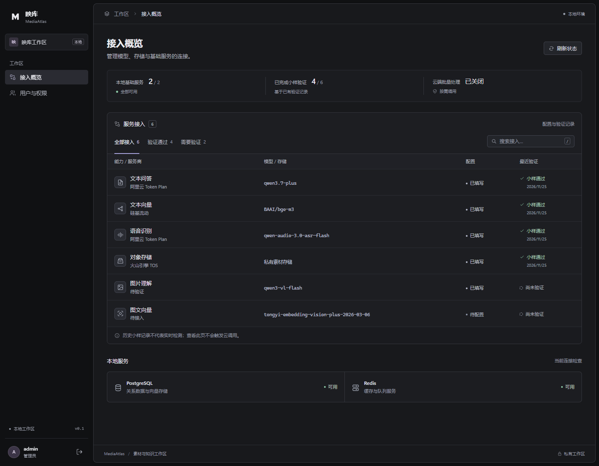
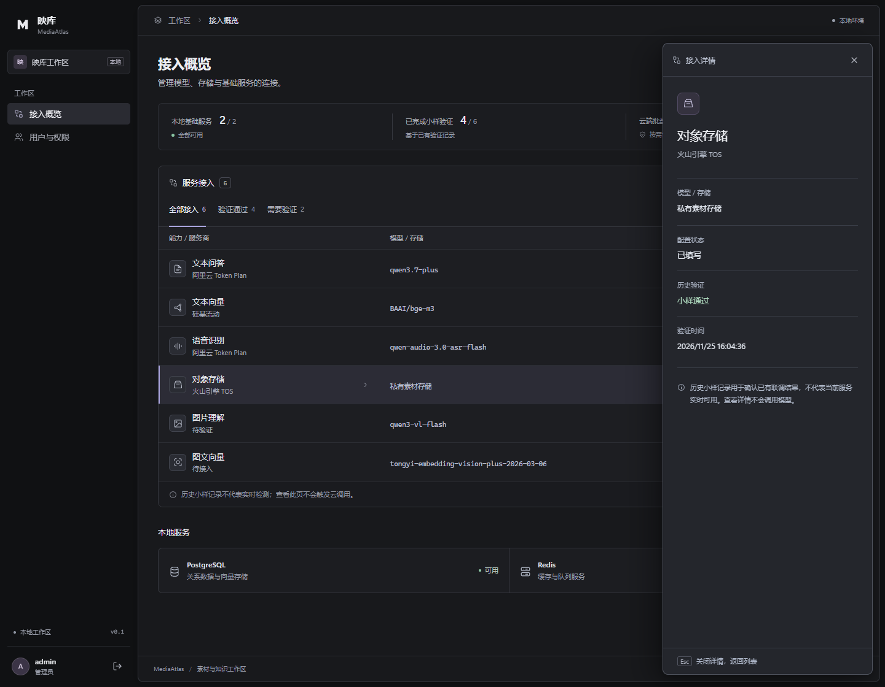
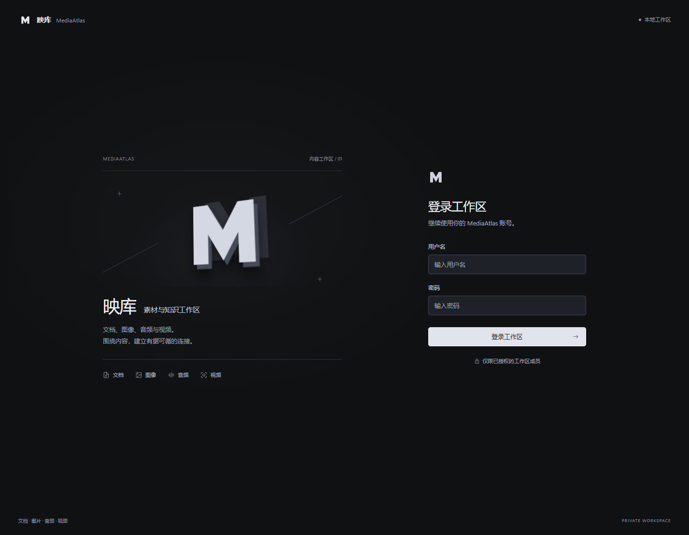
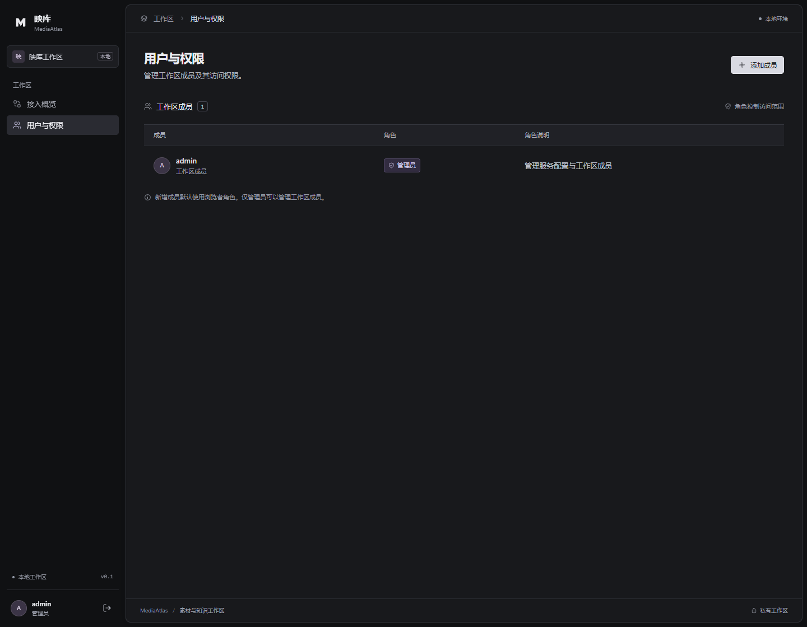
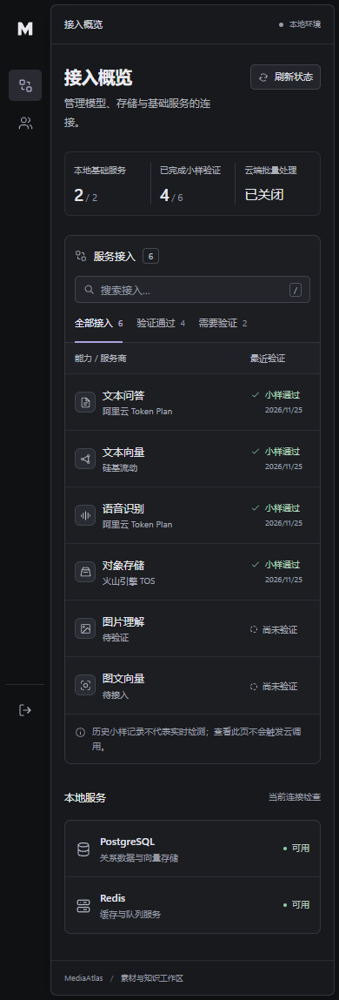
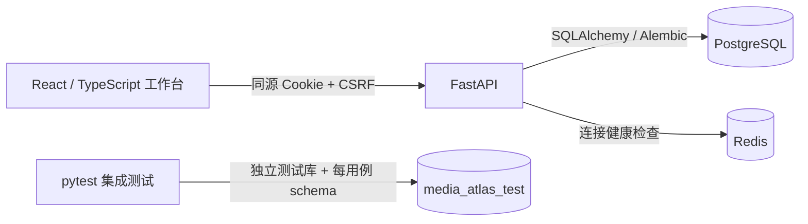

# 映库 · MediaAtlas

面向文档、图片、音频和视频的多模态素材工作区，围绕内容版本、检索证据和审核发布逐步建设。

[](https://github.com/1151014007/Source_material/actions/workflows/ci.yml)

**当前发布为开发中的基础版本。** 可以运行登录、成员权限、服务接入管理与健康检查；完整素材上传、四模态处理、审核发布、统一检索和引用问答尚未交付。下方截图、测试与联调记录均对应已实现部分。

## 界面预览

实际本地运行截图，展示真实服务配置与已有小样记录。





<details>
<summary>查看登录、成员管理与手机界面</summary>







</details>

截图来自维护者的本地环境。原始联调报告不随仓库分发，新克隆环境没有这些历史记录时会显示“尚未验证”，不会自动显示成功。脱敏过程与结果见下文。

## 当前实现

| 模块 | 已实现行为 |
|---|---|
| 身份与会话 | 登录、注销、会话过期与撤销；密码使用 scrypt；会话令牌存储 HMAC 摘要 |
| 工作区权限 | admin / editor / viewer 三角色；成员查询与管理按工作区和角色校验 |
| 浏览器安全 | HttpOnly 会话 Cookie、SameSite=Lax、写操作 CSRF 校验；生产配置要求 HTTPS 与 Secure Cookie |
| 服务接入管理 | 显示配置完整性及历史小样结果；本地搜索、状态筛选、详情面板；刷新保留当前视图，失败数据明确标记 |
| 交互与可访问性 | `/` 聚焦搜索、`Esc` 清空或关闭详情；关闭后恢复焦点；窄屏详情采用模态交互 |
| 本地基础服务 | 独立 PostgreSQL / Redis 容器、端口与数据卷；Alembic 迁移、幂等管理员初始化、健康检查 |
| 自动化验证 | 后端单元与隔离 PostgreSQL 集成测试、前端交互测试、类型检查与生产构建；GitHub Actions 自动运行 |

当前 API 路由覆盖身份、成员管理、接入状态与健康检查。Provider 协议、领域类型和后续模块边界已定义，完整业务适配器与素材流水线继续开发。

## 工程设计



- **测试数据隔离**：拒绝未明确指定的测试地址及不以 `_test` 结尾的库；每用例使用唯一 schema，显式绑定 ORM 与 DDL，防止误读 `public` 同名表。
- **凭据边界**：真实密钥、数据库密码和管理员密码仅在被忽略的 `.env`；初始化补齐缺失字段并保留已有配置，POSIX 新文件按 `0600` 创建。
- **云调用边界**：查看、搜索和筛选接入状态均不触发推理。自动化后端测试拦截外部 HTTP，真实云小样独立执行，批处理默认关闭。
- **失败状态可见**：区分未配置、未验证、验证失败；部分接入信息失败不会遮蔽健康检查结果，首次加载失败不会伪装成历史数据。

技术栈：Python 3.12、FastAPI、SQLAlchemy、Alembic、PostgreSQL / pgvector、Redis、React、TypeScript、Vite、pytest、Vitest。

## 外部接入实测

以下记录证明独立接口可调用，**不代表完整业务流水线、性能或检索质量已经验收**。

| 能力 | 实测配置 | 小样结果 | 记录 |
|---|---|---|---|
| 文本生成 | 阿里云 Token Plan / qwen3.7-plus | HTTP 200，返回预期短文本 | [文本小样](docs/setup/2026-11-25-token-plan-smoke.md) |
| 文本向量 | 硅基流动 / BAAI/bge-m3 | 3 条 1024 维向量，相关文本基础排序通过 | [向量小样](docs/setup/2026-11-25-bge-m3-smoke.md) |
| 语音识别 | qwen-audio-3.0-asr-flash | 中文短音频转写与词级时间戳通过 | [语音小样](docs/setup/2026-11-25-asr-smoke.md) |
| 对象存储 | 火山引擎私有 TOS | 71 字节上传、下载校验、临时签名读取与删除确认通过 | [存储小样](docs/setup/2026-11-25-tos-smoke.md) |
| 图片理解、图文向量 | 待接入或验证 | 尚未验收 | 继续开发 |

套餐的接口可调用性与允许使用范围分别核对；历史成功不保证其他账号、地域、模型或订阅具备同样能力。配置说明见 [云服务准备清单](docs/setup/cloud-configuration.md)。

## 本地运行

需要 Docker Desktop、Python 3.12、[uv](https://docs.astral.sh/uv/)、Node.js 24。基础工作台无需云密钥即可启动。

```bash
git clone https://github.com/1151014007/Source_material.git
cd Source_material
```

Windows 初始化：

```powershell
.\scripts\bootstrap.ps1
```

Linux / macOS 初始化：

```bash
sh scripts/bootstrap.sh
```

脚本安装锁定依赖、初始化 `.env`、启动数据库与 Redis、执行迁移并创建初始管理员。账号密码保存在根目录 `.env` 的 `BOOTSTRAP_ADMIN_USERNAME` / `BOOTSTRAP_ADMIN_PASSWORD`；再次初始化保留已有用户和凭据。

两个终端分别启动：

```bash
# 终端一：API
cd backend
uv run uvicorn app.main:app --host 127.0.0.1 --port 18002
```

```bash
# 终端二：工作台
cd frontend
npm run dev
```

工作台：<http://127.0.0.1:18082>；API 文档：<http://127.0.0.1:18002/docs>。

| 服务 | 本机端口 |
|---|---|
| Web / API | 18082 / 18002 |
| PostgreSQL / Redis | 15433 / 16380 |

Compose project 为 `asset-platform-dev`，端口仅绑定本机。公开部署前需要独立配置 HTTPS、生产 Cookie、访问控制和运维环境。

## 验证方式

```bash
# backend
uv run pytest -q
uv run ruff check app tests migrations ../scripts

# frontend
npm run test
npm run build
```

测试必须使用专用的 `TEST_DATABASE_URL`。本次发布的本地验证：**30 项后端测试、15 项前端测试**；浏览器检查包括登录、接入筛选、延迟刷新、详情与焦点恢复、成员表单、注销，以及 320～1440 像素宽度的布局。GitHub CI 的结果以仓库 Actions 实际运行记录为准。

当前 CI 检查迁移、重复初始化、后端测试、前端测试及构建；完整四模态浏览器流程与检索评测仍属于后续工作，未计入现有测试成绩。

## 后续开发

- [ ] 素材上传、版本、校验与处理任务生命周期
- [ ] 文档解析、图片理解、语音转写与视频时间轴的业务链路
- [ ] 公开内容审核、脱敏与原子发布
- [ ] 文本 / 视觉检索融合与可定位的引用问答
- [ ] 集合导出、服务账号及四模态端到端验收

[总体设计](docs/superpowers/specs/2026-11-24-总体设计.md) · [实施计划](docs/superpowers/plans/2026-11-24-实施计划书.md) · [界面设计](docs/design/2026-11-25-linear-ui.md) · [成本约定](docs/operations/cost-policy.md)

源码、锁文件、空白配置模板、脱敏实测说明与预览截图进入仓库；真实 `.env`、私人素材、原始联调报告、日志、数据库卷、依赖目录和构建产物均不发布。
