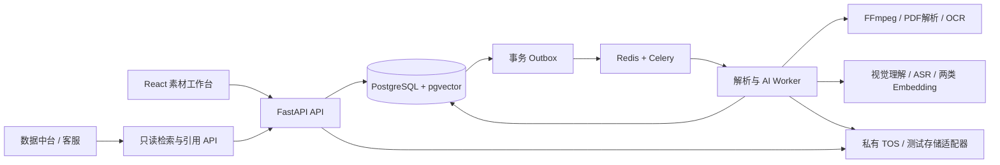

# 多模态素材平台总体设计

日期：2026-11-24（Asia/Shanghai）
状态：供用户审阅的设计草案；仅编写文档，尚未创建产品工程、安装依赖或修改现有项目。
实施计划：[2026-11-24-实施计划书.md](../plans/2026-11-24-实施计划书.md)

## 1. 已确认需求与设计建议

用户已确认：必须建设成多模态素材平台，独立 GitHub 仓库；先提交计划书；云模型优先，保留本地模型替换接口。此前用途是面试展示，因此必须具备可运行代码、真实处理链路、可复核测试与 README 展示材料。

以下是本方案提出的默认值，尚未作为用户已经批准的决定：项目暂名「映库 / MediaAtlas」，仓库建议名 `multimodal-asset-platform`；首版面向单团队，提供文档、图片、音频、视频四类素材；采用模块化单体 API、独立异步 Worker 和 PostgreSQL 检索；默认使用私有 TOS 与百炼云模型；通过只读 API 接入数据中台或客服。

计划存放在 `E:\Desktop\dw\资料\多模态素材平台`。未来工程建议位于 `E:\Desktop\dw\github-ready\multimodal-asset-platform`，实际创建在执行阶段进行。现有 `AI-DMP` 工程、数据库、容器和远程仓库继续独立管理。

## 2. 产品目标与首版完成定义

让内容运营、销售支持和客服从文档、图像和音视频中找到可直接使用、有出处、允许发布的素材。

首版必须同时完成以下业务闭环，不能仅实现多格式上传：

1. 上传四类素材，完成格式核验、内容解析、任务追踪与失败重试。
2. 用自然语言检索图片；上传查询图片，检索相似图片和视频画面。
3. 检索视频的画面、字幕或语音内容，结果返回时间范围并跳转播放。
4. 检索音频的转写内容，返回片段时间并跳转播放。
5. 检索文档内容，返回原文与页码或段落位置。
6. 完成图片脱敏、人审发布、撤回、素材版本追踪；下游只读取已发布版本。
7. 基于检索证据回答问题，提供素材、页码或时间戳引用，无证据时明确返回未找到可靠素材。
8. 独立启动、初始化、数据库迁移、测试、CI、API 文档、截图和 README 全部配套。

本期不做直播处理、视频生成、模型训练、社交平台发布或计费 SaaS。首版不承诺自动消除音视频中的全部隐私；敏感音视频必须上传已经处理的发布版本并人工审核，不能只改转写文本就发布原始媒体。

## 3. 方案比较与推荐

| 方案 | 优点 | 代价与风险 | 建议 |
|---|---|---|---|
| 独立重构，按模块迁移 | 保留成熟技术栈与可复用部件，建立独立领域模型和处理链路 | 需要重建素材、任务、发布与检索模型 | 推荐，本计划据此展开 |
| 全新框架重新实现 | 无历史接口束缚 | 认证、上传、存储、打码等重复建设，验证成本高 | 暂不采用 |
| 在原项目继续增加模块后复制 | 前期页面复用多 | 继续耦合聊天、学员和数据中台，难以证明独立部署 | 不符合独立交付目标 |

推荐方案由助手提出，用户尚未进行最终设计确认。迁移只借鉴经过审查的实现，不把原来的 1,719 行接口和 2,652 行页面整体搬过去。

## 4. 能力边界与可验证示例

| 模态 | 输入 | 提取与理解 | 检索与使用 |
|---|---|---|---|
| 文档 | PDF、TXT、Markdown | 原文抽取；扫描 PDF 按页 OCR；标题、段落、页码与分块 | 关键词、语义、带出处问答；PDF 跳页 |
| 图片 | JPEG、PNG、WebP | EXIF 方向归一化、OCR、视觉描述、候选标签、脱敏版本 | 以文搜图、以图搜图、原文命中与图片预览 |
| 音频 | MP3、WAV、M4A | 媒体校验、标准化、云 ASR、带时间戳转写 | 语义检索、片段定位、带时间播放 |
| 视频 | MP4、MOV、WebM | 媒体探测、封面、关键帧、音轨转写、帧 OCR 和视觉向量 | 画面与台词双路径检索，时间轴与片段播放 |

示例：输入“展示蓝色仪表盘的产品介绍”能够在没有人工同名标签的情况下命中图片或视频关键帧；输入视频中出现的一句话能够命中 ASR 片段；上传一张局部相似的截图能够命中对应素材。评测素材、正确答案和检索结果必须留档，不能把标签匹配展示成视觉检索。

## 5. 系统架构与技术选择

技术建议：Python 3.12、FastAPI、SQLAlchemy 2、Alembic；PostgreSQL 17 + pgvector 0.8 系列；Redis 7 + Celery 5；React 18 + TypeScript + Vite，保留原工程熟悉的前端基础。使用 pypdf 抽取 PDF、pypdfium2 按页渲染、RapidOCR 识别文本、Pillow 处理图片、FFmpeg/ffprobe 处理音视频。实际依赖在实施时核验兼容性并锁定，不把浮动版本作为可复现交付。

本机只读检查：物理内存约 15.4 GiB、RTX 3060 Laptop GPU，Docker 命令可用，当前 PATH 未发现 FFmpeg。首版将 FFmpeg 放入 Worker 镜像，云模型承担主要推理，不强制 GPU；开发环境 Worker 并发 2，重媒体任务并发 1。此处是资源规划，不是已测性能。

### 5.1 模型配置与替换边界

| 接口 | 默认实现建议 | 输出与约束 |
|---|---|---|
| `VisionProvider.describe(image)` | 百炼可用的 Qwen VL 快照；配置项 `VISION_MODEL` | JSON 描述、候选标签、模型标识；模型推断与人工字段分开保存 |
| `AsrProvider.submit/poll(audio)` | 百炼 `paraformer-v2` 文件转写 | 返回持久化供应商任务 ID、句子文本、毫秒起止时间 |
| `TextEmbeddingProvider.embed(texts)` | `text-embedding-v4`，1024 维 | 文档、转写、OCR、描述的文本语义索引 |
| `VisualEmbeddingProvider.embed_text/embed_image` | `tongyi-embedding-vision-plus-2026-03-06`，1152 维，独立向量模式 | 同一视觉空间内进行文本对图片、图片对图片、图片对视频帧检索 |
| `AnswerProvider.answer(evidence)` | 可配置文本问答模型 `ANSWER_MODEL` | 仅依据检索证据回答，引用 ID 必须来自输入集合 |

上面两个 Embedding 是不同空间，禁止直接比较或相加原始相似度。视频首版以关键帧视觉向量加 ASR 文本向量实现检索，不宣称原生端到端视频语义模型。

本地替换首版交付 Provider 协议、契约测试和配置切换；不承诺所有本地模型也在首版完成部署。首版运行时只支持固定1024/1152维的同维模型替换；其他维度必须先新增对应列/表、索引与迁移测试，不能靠修改环境变量生效。模型空间包含供应商、快照、维度、模式及归一化参数。无密钥时界面显示未配置、仍允许基础归档；不得伪造 AI 结果。

每团队只有一个活动 `index_profile`，绑定查询侧模型配置；每素材的 generation 属于该 profile。换模型时先在新profile为全部当前发布版本构建并评测；切换前持有团队级锁，核对publication_revision，期间有新发布/撤回则补建或中止重试，不能遗漏变更。全部就绪后事务切换活动profile；不逐素材混用查询空间。失败继续旧profile，旧索引保留到回滚窗口结束。

模型开通地区与可用快照在任务 T01 做真实小样探测；如果建议模型在账户地区不可用，替换为同类模型后更新模型清单与向量迁移，再进入批量处理。官方依据见文末。

### 5.2 对象存储与访问

正式链路使用私有 TOS：原件、发布件和中间产物分前缀存放；不使用拼接的永久公开链接。CI 使用临时目录中的 LocalStorage 适配器；本地无云配置仅承诺归档、浏览和契约测试，不把这当作云模型验收。

浏览器通过同源鉴权内容网关访问文件，支持 HTTP Range 与 PDF/视频定位；服务账号也通过鉴权网关取发布素材。内容地址必须带 `version_id`，segment引用同时保存generation；如果该版本不再是当前发布版本，viewer/服务账号返回410，不自动打开新版；admin/editor可通过独立的原件/历史接口访问本团队草稿和历史，操作审计。不得用仅asset_id的URL承载不可变证据。

内部 Worker 在调用 ASR 等服务前即时生成受限时效的供应商输入链接（默认2小时），首轮验证百炼执行环境确实可读取私有TOS输入。已提交供应商任务的URL不能原地替换：先轮询原任务，只有明确输入链接过期且供应商任务终止时，才创建新尝试和新签名；提交结果不明转ambiguous。签名不写入导出或日志。

## 6. 领域模型与一致性规则

| 表/模型 | 关键字段与职责 |
|---|---|
| `workspaces/users/memberships` | 首版初始化一个团队；admin、editor、viewer 三角色；所有业务数据按 workspace 隔离 |
| `assets` | 素材逻辑 ID、模态、目录、人工标题、标签、当前版本与已发布版本、删除时间 |
| `asset_versions` | 不可变内容修订；文件对象、人工元数据快照、输入哈希、来源、隐私级别、处理状态、配方版本、创建者；编辑元数据产生新修订，可复用同一物理文件 |
| `storage_objects` | workspace、SHA-256、大小、对象 key、状态；同团队去重，版本引用同一物理文件 |
| `asset_derivatives` | 缩略图、预览、关键帧、脱敏件、转写文件；归属具体版本 |
| `asset_segments` | 文本/页面/帧/音视频片段；页码或毫秒时间范围、抽取原文、公开文本、来源类型 |
| `text_embeddings` | segment、1024 维向量、model_space、generation |
| `visual_embeddings` | image/frame segment、1152 维向量、model_space、generation |
| `jobs/outbox_events` | 阶段任务、幂等键、尝试次数、lease、错误码、供应商任务 ID；事务内登记待发送事件 |
| `publications/publication_items` | 审核后的版本与检索代次快照；一次发布固定一组引用 |
| `index_profiles` | 团队级活动模型空间与查询配置；换模型全量构建后统一切换；各publication按profile关联其generation |
| `reviews/audit_events` | 审核绑定发布文件SHA-256、元数据hash、公开segments hash与配方版本；批准/驳回、撤回、原件访问与删除记录，不记录敏感原文 |
| `exports/service_accounts` | 导出清单、文件摘要、版本；只读服务账号的令牌摘要、scope、失效时间 |

所有外键、状态枚举和必要唯一约束通过 Alembic 建立。目录与素材分表，目录禁止跨团队引用和循环移动；目录删除默认要求为空，用户明确选择递归删除时生成可追踪删除任务。

上传校验：声明值不可信，以文件魔数、解码结果、真实大小、SHA-256 和存储 HEAD 核验结果为准。直传只写会话暂存key，complete幂等复制至上传方不可覆写的终态key，核验和后续处理只读取终态对象；重复complete返回同一版本，不能登记任意key。并发去重只复用active对象，pending_delete/deleting对象不得新增引用；删除与引用变更使用对象行锁，原件、发布件和全部派生件都参与引用保护。

处理状态：`uploaded → queued → processing → ready | failed`。审核状态独立：`draft → review_ready → pending_review → approved | rejected`。review_ready要求文件核验、可播放/可预览发布候选、该候选的公开OCR/转写/描述及人工元数据全部就绪；审核绑定文件和公开内容摘要。审核后只生成向量，不悄悄改写已审内容。更换候选/编辑内容建立新修订，使原待审/待发布任务失效。发布只在批准与候选索引全部就绪后事务切换；失败不替换旧发布版本。

云文件删除使用 `pending_delete → deleting → deleted | retry_wait`：先在事务内隐藏并登记 Outbox，再异步删除对象；物理文件无其他版本引用才清理；失败保留记录和重试信息。前端显示删除处理中，不提前声称已彻底清理。

## 7. 内容处理规则

默认硬限制：TXT/MD 5 MiB；PDF 50 MiB、200 页；图片 20 MiB、解码后 3,000 万像素；音频 200 MiB、60 分钟；视频 500 MiB、30 分钟。超限明确拒绝，限制由服务端与代理一致执行。查询图片最大 10 MiB、3,000 万像素。解码、渲染和 FFmpeg 均在有超时、临时目录和资源限制的 Worker 执行，禁止拼接 shell 命令、禁止用户传入远程 URL。

- 文档：优先原文提取，空文本页进入 OCR；按标题和句子分块，默认最多 800 个 Unicode 字符、100 字符重叠；页码/段落定位不丢失；加密 PDF 明确拒绝并说明原因。
- 图片：按 EXIF 归一化，生成长边不超过 1600 像素且不超过 5 MiB 的模型输入；保留 OCR 框、描述与置信信息；原件不被覆盖。
- 音频：生成浏览器播放件M4A/AAC及供应商音轨，二者使用一致的归零时间基准；检索片段不超过30秒，长句再拆分。无语音记录no_speech，可按人工元数据归档与发布，不产生虚构语音证据。
- 视频：ffprobe校验后生成MP4/H.264/AAC、yuv420p、faststart播放件，关键帧间隔最多2秒；无音轨不强行生成。抽帧和ASR均以该播放件为时间基准，保留原件到播放件的起始偏移。每10秒锚点加场景候选，去重与均匀覆盖后最多180帧；所有保留帧执行本地OCR和视觉向量，最多12张代表帧执行视觉描述。帧文字进入带时间定位的文本索引，纯画面问答只使用已有视觉描述/OCR作为证据，无文本描述的帧可返回检索卡片但不生成画面事实答案。无声视频仍走视觉链路。
- 阶段重试最多 3 次，退避 5/30/120 秒（仅为本地重试等待，长任务由队列调度，不阻塞 API）；429/暂时性网络错误重试，格式错误直接失败；供应商异步轮询不计为重新提交。
- 幂等键固定为 `(asset_version_id, stage, recipe_version, config_hash)`；config_hash必须包含实际输入文件/segments摘要、目标profile/generation与模型参数。提交结果时用lease_id进行条件更新，过期Worker不得回写或发布。FFmpeg进程超时为max(120秒,4倍媒体时长)，上限2小时；云异步等待不占用进程。外部API提交响应丢失转ambiguous并终止自动重投，管理员核实供应商记录后显式重试，保留可能重复计费说明。

## 8. 隐私、审核与发布

云处理与对外发布是两种授权。沿用用户已选择的云优先方案：验收集和普通素材允许云处理；每版本及查询图保存cloud_processing=allowed/blocked，敏感原件默认blocked，Provider调用前服务端强制核验。blocked内容只走本地解析/OCR，敏感音视频须先提供已处理候选，管理员明确将该候选标为allowed后才能调用云ASR/视觉；首版不靠未部署的本地模型承诺这条能力。旧私人资料不自动导入，查询图默认按工作区允许云处理策略并在查询入口说明。

图片自动处理只生成候选：OCR 敏感文本规则加头像/昵称候选，展示可编辑遮罩；最终发布件采用不可逆覆盖或马赛克。没有识别到区域、空遮罩或识别失败都不能自动认定安全。人工确认无需脱敏也必须保留审核理由和版本摘要。admin/editor可查看本团队原件、原始OCR和遮罩候选，viewer/service只读当前发布件及其公开文本。

对外检索只使用已批准的发布件生成的文本与视觉向量。脱敏图片的 OCR 和视觉描述重新生成，不能沿用原图识别出的姓名、电话作为公开索引。原始 OCR 仅限管理人员，普通日志只写 asset/job/error ID。

音视频和 PDF 发现敏感信息时，首版支持替换已处理的发布件并重新解析审核；不实现半成品自动抹人脸、改音轨或伪 PDF 遮罩。原件与发布件明确绑定，审核引用发布件 SHA-256。

撤回或删除后 API 立即停止返回该素材及签发媒体访问；内容网关每次请求校验发布状态，已有浏览器缓存或已下载文件无法追回。导出清单注明快照时间与撤回限制。

Web 使用同源 HttpOnly 会话 Cookie（生产 Secure、SameSite=Lax）与写操作 CSRF 校验，解决图片/视频标签无法附加 Bearer 的问题。viewer 只看已发布件，editor 管理草稿，admin 审核、服务账号和用户；下游令牌只有 `assets:search`、`assets:read_published` 权限，不可访问原件。

## 9. 统一检索与引用问答

文本查询并行召回：精确标识/标签/`pg_trgm` 词面匹配 Top 50、1024 维文本语义 Top 50、同一视觉模型产生的文本查询向量召回图片/帧 Top 50。每路在召回前约束workspace、当前发布版本与活动profile；ANN过滤后不足时迭代扩大候选或对可见集合精确回退，不能把草稿候选送入RRF或问答。中文词面路径首版采用trigram，不把英文分词配置当作中文分词器。

使用 RRF `sum(1 / (60 + rank))` 融合排名；过滤 workspace、published、当前发布版本后再返回。图片查询使用视觉空间召回图片/帧；如果同时输入文字，两组结果按排名融合。每素材默认保留最多 3 个不重叠片段，文档按页、音视频按时间去重；返回命中路径与证据。

统一结果字段：`asset_id/version_id/segment_id/modality/title/snippet/page/start_ms/end_ms/hit_sources/preview_endpoint`。分数仅用于相同查询内排序，不包装为真实概率。

问答先检索，再把最多 8 个证据片段交给模型；回答引用必须映射到返回的 segment。没有有效引用、拒答或超时不能输出看似有证据的答案；检索仍可独立使用。

索引采用新 generation 后台构建，校验段数、向量维度与有限数值后事务切换发布指针；失败保留旧 generation。禁止混合不同模型、维度或不同脱敏版本的向量。

## 10. 页面与 API 边界

页面：工作台、素材库、上传与任务中心、统一检索、文档详情、图片详情与遮罩编辑、音视频详情与时间轴、审核发布、集合与导出、设置与服务账号。前端按 `features/assets|ingestion|search|review|settings` 拆分，使用统一分页/筛选请求，不在本地再删掉服务端命中结果。

主要接口前缀 `/api/v1`：

- 上传：`POST /uploads`，`POST /uploads/{id}/complete`，代理上传备选 `POST /assets/upload`。
- 素材：`GET /assets`（cursor、limit 默认 30，最大 100）；`GET /assets/{id}`；`POST /assets/{id}/versions`；`PATCH /assets/{id}`；`DELETE /assets/{id}`（202 + job_id）。
- 内容与证据：`GET /assets/{id}/versions/{version_id}/content`（Range）；`GET /assets/{id}/versions/{version_id}/segments`（分页）；原件/历史另设editor/admin接口；`POST /queries/images`（短时查询图句柄）。
- 处理：`GET /jobs`；`GET /jobs/{id}`；`POST /jobs/{id}/retry`；`POST /assets/{id}/reprocess`。
- 检索：`POST /search`（query_text/query_image_id/filters/limit）；`POST /answers`。
- 审核与发布：`POST /assets/{id}/submit-review`；`POST /assets/{id}/reviews`；`POST /assets/{id}/publish`；`POST /assets/{id}/unpublish`。
- 导出：`POST /exports`（202）；`GET /exports/{id}`；`GET /exports/{id}/content`。

新 API 不读取原系统学员、聊天、知识库表；下游通过新平台的服务账号接入，原系统喜报绑定继续留在数据中台。

## 11. 验收数据与发布门槛

交付前建立固定、有来源清单且不含真实隐私的样本：文档 15 份、图片 50 张、音频 5 段、视频 10 段，总计 80 项，音视频合计不超过 60 分钟。样本是可复现验收集，界面内容使用正常业务名称，README 如实说明来源与规模。

另建80条人工标注检索问题，按类分层为“总数/调参/冻结”：文档16/4/12、以文搜图20/5/15、以图搜图16/4/12、视频画面12/3/9、音频台词8/2/6、视频台词8/2/6，共80/20/60。问题字段包含relevant_asset_ids与可接受定位点；近重复素材不跨调参/冻结集合。

门槛是待达成目标，不是既有成绩：每题标注1–5个相关素材，按去重后的Top5素材计算 `Recall@5=命中相关素材数/该问题相关素材总数`，先逐问题再求宏平均；冻结集总体≥0.85，每类≥0.75（音频与视频台词分开统计）。片段定位另外计分，不拿同素材多个片段充当多个素材命中；10个指定台词样例设置expected_seek_ms，命中区间覆盖该点，播放器定位与expected_seek_ms误差≤2秒。全部引用可定位、公开索引无原始敏感标记、无证据拒答与撤回旧URL失效均为硬门槛。云验证报告记录模型、日期、用量与失败。

检索性能在1万条segment上测量，记录机器、并发5、预热方式和样本分布；数据库与融合p95≤300ms、含云查询向量端到端p95≤5s是优化目标，偏离必须在README列实测差距，不作为首版唯一发布阻塞项。API检索超时20秒；功能持续超时、四模态不通、安全/一致性或上述质量门槛失败则阻塞发布。不得用缓存结果冒充云模型实际时延。

CI 必须通过：后端单元与隔离 PostgreSQL 集成测试、前端交互测试、Playwright 四模态流程测试（云接口替身）、迁移与构建、密钥与私有素材检查。真实云模型与 TOS 验收单独执行，不能用 mock 全绿替代。

## 12. 迁移与交付边界

可复用候选：TOS SDK 封装思路、OCR 框提取、Canvas 笔刷交互、鉴权测试、基础前端组件。必须重做：素材领域表、目录关系、任务与补偿、索引与发布、查询协议、前端功能结构。原始自动打码“零区域返回原图即成功”、未脱敏导出回退原图、永久公开链接和写死脚本知识库不迁移。

迁移工具默认 dry-run；显式指定原数据源和目标新库，输出旧 ID→新 ID、文件哈希与失败清单；目标通过 API 或显式 importer 创建，不写原库。旧已打码标记不继承审核通过状态。先使用验收集交付独立仓库，再由用户选择是否导入旧素材。

仓库交付：来源与许可证清单、环境变量占位模板、独立Compose、迁移与初始化脚本、API示例、固定验收集及清单、测试与评测报告、8–10张真实页面截图、架构图、故障恢复说明。开发默认预留web18082、API18002、PostgreSQL15433、Redis16380，启动前检查占用；Compose project固定独立前缀asset-platform-dev，新库media_atlas，新卷与网络独立。测试URL必须显式指向以_test结尾的新测试库，缺失或命中业务库则拒绝运行；不能继承AI-DMP环境。仓库名和GitHub链接发布时采用用户提供值，本次不创建远程仓库或推送。

## 13. 依赖、费用与待提供信息

实施到真实云联调时需要：新的项目模型配置（百炼地区、API Key、可用模型），私有 TOS bucket、区域与最小所需读写配置；值通过本地 `.env` 配置，不写进计划书或聊天。公共样本由项目准备；用户业务素材只在后续明确选择导入时使用。

费用由 ASR 音频时长、视觉理解图片/帧数、两类向量输入量、存储与流量构成。首轮只跑 4 个小样，确认模型可用和每项用量后再扩展验收集；不提前承诺固定价格或默认用户已授权无限额调用。

实施估算：按一名熟悉技术栈的工程师约 25–35 人日规划（非承诺工期），外部模型开通与用户审阅另计。阶段依赖与可检查任务见实施计划。当前只交付文档，不执行收费调用。

## 14. 官方资料与核验说明

技术资料于 2026-11-24 查阅；具体账号地区、模型权限和依赖锁定仍需实施探测。

- [百炼文本与多模态模型清单](https://www.alibabacloud.com/help/en/model-studio/embedding-rerank-model)：文本模型和视觉模型的用途、维度选择。
- [多模态向量 API](https://help.aliyun.com/en/model-studio/multimodal-embedding-api-reference)：共享视觉语义空间、独立/融合向量与快照模型。
- [文件语音转写](https://help.aliyun.com/en/model-studio/non-realtime-speech-recognition-user-guide)：异步任务和句子/词时间戳。
- [pgvector 官方项目](https://github.com/pgvector/pgvector)：向量、HNSW、过滤和混合检索的基础能力。
- [Celery 任务文档](https://docs.celeryq.dev/en/stable/userguide/tasks.html)：任务确认、重试与幂等处理依据。
- [FFmpeg 文档](https://ffmpeg.org/ffmpeg.html)：媒体探测、音轨与抽帧处理基础。
